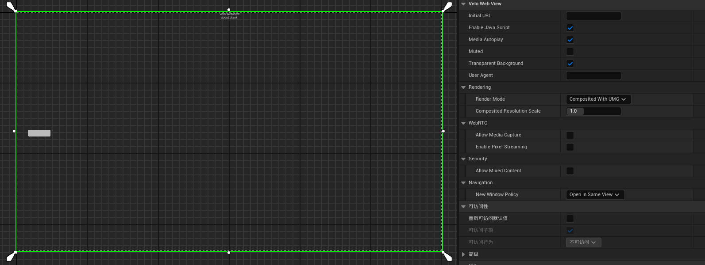
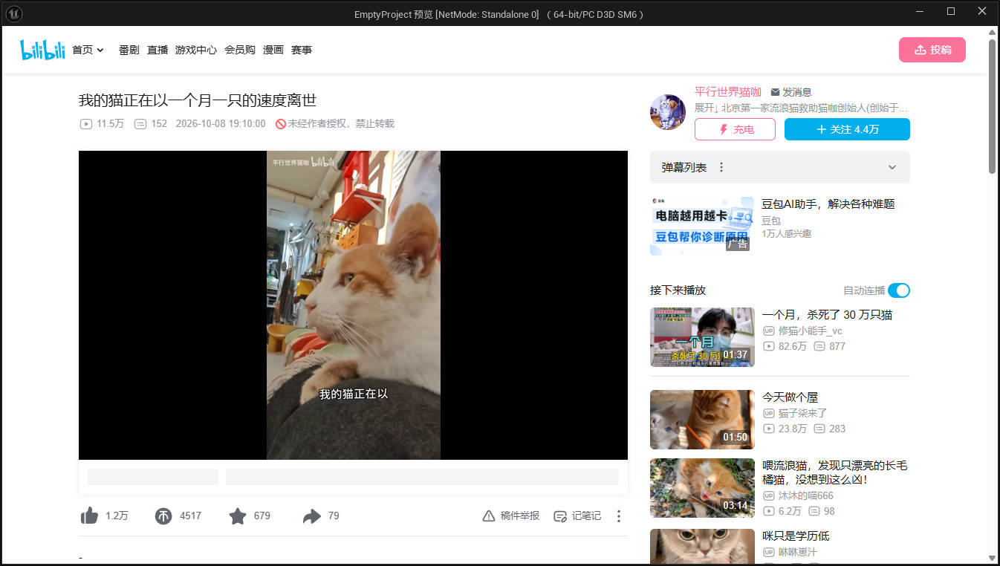
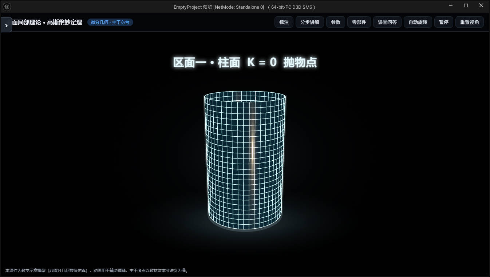
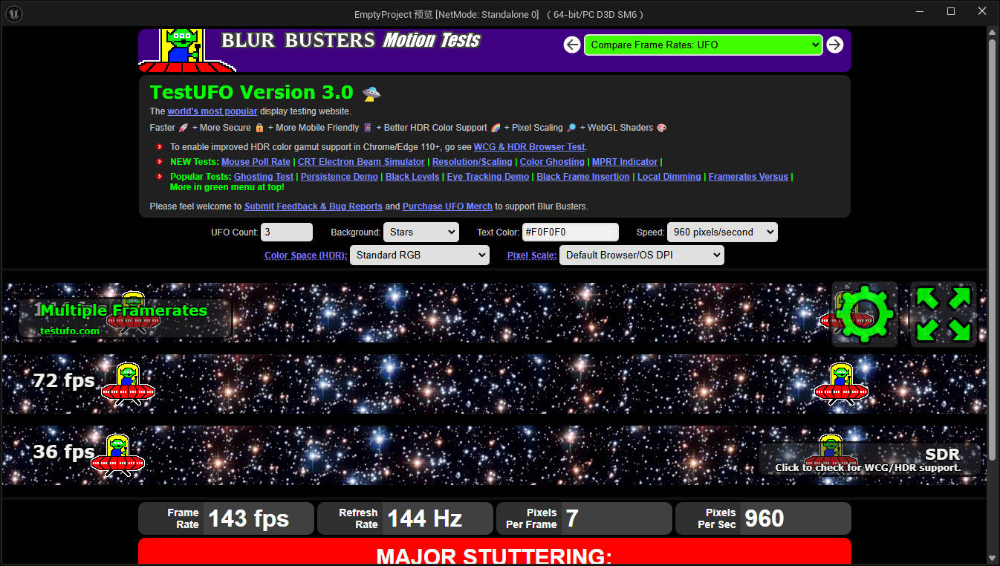

# 我做了一个免费的 Unreal Engine WebView 插件：VeloWebView

> 为了在 Unreal Engine 里嵌入网页，我不想再为一个 WebView 插件支付订阅费，于是决定自己做一个，并把它免费分享出来。

如果你也在 Unreal Engine 项目里做过网页界面、活动页、直播页、视频播放器，应该遇到过同一个问题：引擎自带的浏览器能力不够完整，网络上的第三方 WebView 插件有的价格不低，有的需要订阅，有的还不是买断制。

对个人开发者、小团队和独立游戏来说，WebView 往往不是核心产品，却可能变成一笔持续的成本。更麻烦的是，付费并不一定意味着完全符合项目需求：UMG 的层级关系、网页视频、H.264、JavaScript 通信、Android 和 Windows 的差异，还是要自己验证。

所以我做了 **VeloWebView**。

项目地址：[github.com/BssnakeMing/VeloWebView](https://github.com/BssnakeMing/VeloWebView)

Windows 和 Android 的可直接使用包：[VeloWebView v1.0.0 Release](https://github.com/BssnakeMing/VeloWebView/releases/tag/v1.0.0)

---

## VeloWebView 是什么

VeloWebView 是一个面向 Unreal Engine 5.4 的 WebView UMG 插件，目标是把网页内容放进游戏 UI，同时保留 Unreal 的 Widget 工作流。

它支持两种显示方式：

- **Composited With UMG**：网页先渲染成纹理，再通过 Slate/UMG 显示。普通 UMG 的 ZOrder 可以控制网页和按钮、面板之间的层级。
- **Native Overlay**：使用平台原生浏览器视图。Windows 使用 WebView2，Android 使用系统 WebView，适合更看重原生视频、权限和全屏行为的场景。

插件的核心模块不直接暴露 WebView2 或 JNI 类型，Windows 和 Android 的平台实现通过独立模块接入。这样做的目的很简单：蓝图和上层 C++ 代码尽量保持一致，平台差异交给插件内部处理。



*在 Widget Blueprint 中可以设置初始 URL、JavaScript、自动播放、透明背景、渲染模式、分辨率倍率和新窗口策略。*

---

## 为什么没有直接买现成插件

我最初也认真看过现成方案。它们有不少优点，文档、功能和支持都可能比个人项目完整，但价格和授权方式让我很难接受。

WebView 在很多项目里是辅助功能，可能只是登录页面、公告页、活动页、网页播放器或直播入口。为了这些功能长期支付订阅费，成本会一直累积；如果项目只是个人练习、独立开发或内部工具，持续授权也会增加发布压力。

这让我决定自己实现一个基础版本：

1. 先把 Unreal Engine 5.4 的 UMG 组件和 Blueprint API 做出来。
2. 把 Windows 和 Android 的平台代码拆开。
3. 解决网页与 UE 之间的 JavaScript 消息通信。
4. 在 Windows 上把 CEF 放到独立的 BrowserHost 进程，避免把 CEF 直接塞进 UE 进程。
5. 做出可以运行、可以打包、可以复现问题的版本。
6. 免费发布源码和可直接使用的 Release 包。

它不是一个商业插件，也没有订阅墙。你可以下载、阅读源码、修改，或者把它作为自己项目的起点。

---

## 目前已经能做什么

VeloWebView 目前覆盖了日常项目最常用的一组能力：

- 加载 URL 和本地 HTML
- 前进、后退、刷新、停止
- 执行 JavaScript
- 获取当前 URL、标题和加载状态
- JavaScript 向 UE 发送消息
- UE 向网页执行脚本
- Cookie 写入、读取和删除
- 页面加载、标题、控制台、下载、权限和全屏事件
- `target="_blank"`、`window.open()` 的新窗口策略
- Windows CEF 组合渲染
- Windows WebView2 原生覆盖层
- Android WebView 组合渲染和原生覆盖层
- Host HTML 和 iframe 辅助模板
- H.264/AAC 视频播放测试页面

网页侧可以这样向 UE 发送消息：

```javascript
window.VeloWebView.postMessage("hello");

window.VeloWebView.postMessage(
  JSON.stringify({
    event: "VideoStarted",
    id: "10086"
  })
);
```

在蓝图或 C++ 中绑定 `OnJavaScriptMessage`，就可以收到这段字符串。

C++ 中的基本用法也很直接：

```cpp
UPROPERTY(meta=(BindWidget))
TObjectPtr<UVeloWebView> WebView;

void UMyWidget::NativeConstruct()
{
    Super::NativeConstruct();
    WebView->LoadURL(TEXT("https://example.com"));
}
```

---

## UMG 层级是我比较在意的一点

很多原生 WebView 的问题不在于网页能不能显示，而在于它显示之后会盖住谁。

原生子窗口通常不理解 UMG 的层级关系。你在 UMG 里放了一个弹窗、按钮或提示条，最后可能发现它们被浏览器视图挡住了。VeloWebView 的 Composited With UMG 模式就是为了解决这个问题：网页画面进入 Slate，普通 UMG ZOrder 可以继续工作。


当然，组合渲染和原生视图各有取舍。组合渲染更容易融入 UI，原生覆盖层在视频、权限、全屏和输入行为上通常更接近平台浏览器。插件把选择权交给项目，而不是强制所有场景使用同一种模式。

---

## 我花了一天时间自己编译 CEF

这是整个项目里最花时间、也最有成就感的一部分。

为了让 Windows 组合渲染支持更完整的视频能力，我没有只停留在系统 WebView2 路径，而是自己准备并编译了带相关编解码能力的 CEF 运行时。CEF 本身就很大，Chromium、工具链、构建参数、依赖和输出文件都需要处理；再加上 Unreal 插件要从独立进程启动 BrowserHost，目录结构和运行时文件也必须配好。

这部分我大概花了一天时间，完成了：

- CEF 154 Windows x64 运行时准备
- Release、非组件化构建
- H.264 相关构建参数配置
- BrowserHost 与 CEF 的链接
- DLL、pak、dat、bin 和 locales 文件整理
- UE 插件打包时的运行时依赖配置
- H.264 能力页验证
- H.264/AAC MP4 播放验证

CEF 的构建产物很大，所以源码仓库没有直接把整套 CEF 二进制塞进 Git。项目提供了一个可直接使用的 UE5.4 Release 包，也在文档里提供了 CEF 运行时下载地址。

CEF 下载地址：[CEF_154.0.32...UE_WebBrowser.zip](https://1823780428.share.123pan.cn/123pan/MRgYjv-vIFOH?pwd=9lfo)

提取码：`9lfo`

---

## 实际测试画面

### 网页视频和 H.264



这是在 Unreal 窗口中播放网页视频的测试画面。H.264 能否播放，最终会受到 CEF 构建参数、系统环境、媒体格式、服务器响应头和浏览器策略影响，因此我把它单独做成了测试页，而不是只在文档里写“支持视频”。

项目里的 `Content/CodecTest.html` 可以用来检查视频能力。对于自动播放，网页本身仍然需要遵守浏览器规则，通常要配合 `muted`、`playsinline` 或用户手势。

### Three.js 和 3D 网页内容



WebView 不只是用来显示一张普通网页。Three.js、教学演示、交互式 3D 页面也可以作为 Unreal UI 的一部分加载。这个方向对工具类项目、数字孪生、配置面板和内容管理界面都比较有用。

### 高刷新率网页测试



这张图是网页高刷新率测试页面。它说明插件可以承载高频更新的网页内容，但它不是一个统一的性能承诺。实际帧率还会受到分辨率、网页复杂度、浏览器进程、CPU/GPU、窗口大小和渲染模式影响。

目前 Windows 组合渲染首先完成的是稳定的 CPU 帧环路径，D3D12 跨进程共享纹理和 GPU fence 仍在继续完善。也就是说，项目可以用来做真实功能和原型，但在极限 60 FPS、低延迟输入和重型网页场景下，仍然需要根据目标硬件进行测试。

---

## Windows 和 Android 的实现思路

### Windows

Windows 组合渲染通过独立的 `BrowserHost` 进程启动 CEF。UE 侧通过版本化的命名管道和共享内存协议与 BrowserHost 通信。

这样做有几个好处：

- CEF 不直接加载进 Unreal 主进程
- 浏览器崩溃和 UE 主进程之间有更清晰的边界
- 可以单独替换 CEF 运行时
- BrowserHost 可以处理网页输入、导航、渲染和媒体能力
- UE 侧只需要接收浏览器状态和画面帧

原生覆盖层模式仍然保留 WebView2 路径，适合需要原生浏览器行为的场景。

### Android

Android 继续使用系统 WebView 和 Unreal 的浏览器纹理路径。原生覆盖层模式使用 `android.webkit.WebView`，权限、全屏、视频和系统 WebView 提供者由 Android 平台处理。

Android 还需要注意设备上的 System WebView/Chrome 版本、权限声明、Activity 生命周期和不同分辨率下的 SurfaceView 坐标。

---

## 如何开始使用

最简单的方式是下载 Release：

[下载 VeloWebView-1.0.0-UE5.4.zip](https://github.com/BssnakeMing/VeloWebView/releases/download/v1.0.0/VeloWebView-1.0.0-UE5.4.zip)

解压到 Unreal 项目的 `Plugins` 目录，启用插件并重新生成项目文件，然后编译一次目标工程。

如果使用源码：

1. 克隆 GitHub 仓库。
2. 把 CEF 运行时放到 `ThirdParty/CEF`。
3. Windows 下构建 `BrowserHost/VeloWebViewBrowserHost.exe`。
4. 让打包过程把 CEF 的 DLL、pak、dat、bin 和 `locales` 目录放到正确位置。
5. 根据项目需求选择 Composited With UMG 或 Native Overlay。

完整构建说明在：

- [项目 README](https://github.com/BssnakeMing/VeloWebView/blob/main/README.md)
- [CEF 下载说明](https://github.com/BssnakeMing/VeloWebView/blob/main/Docs/CEF_DOWNLOAD.md)
- [构建文档](https://github.com/BssnakeMing/VeloWebView/blob/main/Docs/BUILD.md)

---

## 目前的限制

VeloWebView 还在持续开发，当前需要提前知道这些限制：

- Windows 的 D3D12 跨进程共享纹理路径仍在开发中。
- CPU 帧环不是最终的高性能 60 FPS GPU 路径。
- 输入法和复杂的键盘组合输入还需要继续完善。
- Popup 纹理、DevTools、完整的 JS 权限请求响应还没有全部完成。
- Native Overlay 会受到平台原生窗口 ZOrder 和矩形裁剪限制。
- 视频、DRM、文本输入和帧率在不同平台上可能有差异。
- CEF、Chromium、FFmpeg、H.264/AAC 等第三方组件需要遵守各自的许可证和发布要求。

所以我更希望把它定位成一个真实可用、可以继续改进的开源基础，而不是宣称所有浏览器场景都已经完美解决。

---

## 写在最后

我做 VeloWebView 的初衷很简单：不想因为一个 WebView 功能被长期订阅费绑住，也希望个人开发者和小团队能有一个可以自由使用、自由修改的选择。

从最初的 UMG 组件，到 Windows 独立 BrowserHost，再到自己花一天编译 CEF、验证 H.264 和整理可发布的运行时，这个项目并不是一次写完的。很多问题都需要在真实工程里反复运行、打包和验证。

如果这个插件对你有用，欢迎使用、提 Issue、提交修复，或者把你的测试结果分享回来。项目会继续免费维护和分享。

GitHub：[BssnakeMing/VeloWebView](https://github.com/BssnakeMing/VeloWebView)

Release：[VeloWebView v1.0.0](https://github.com/BssnakeMing/VeloWebView/releases/tag/v1.0.0)
